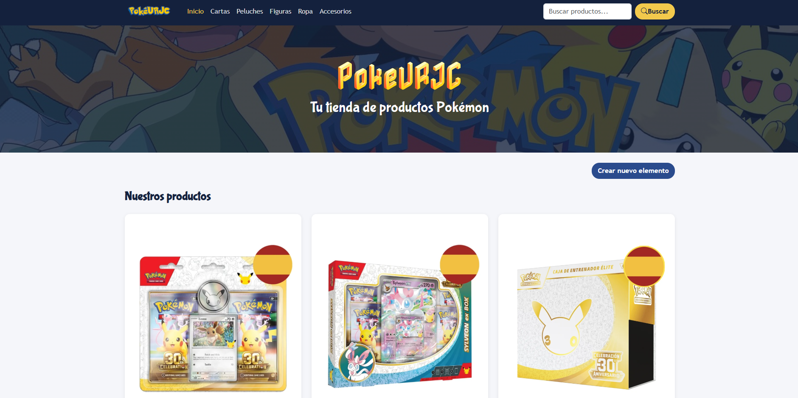
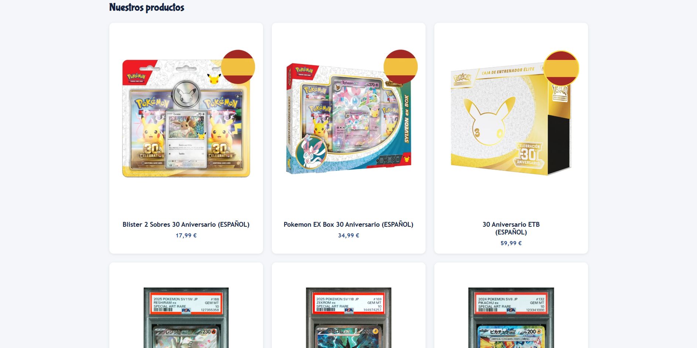
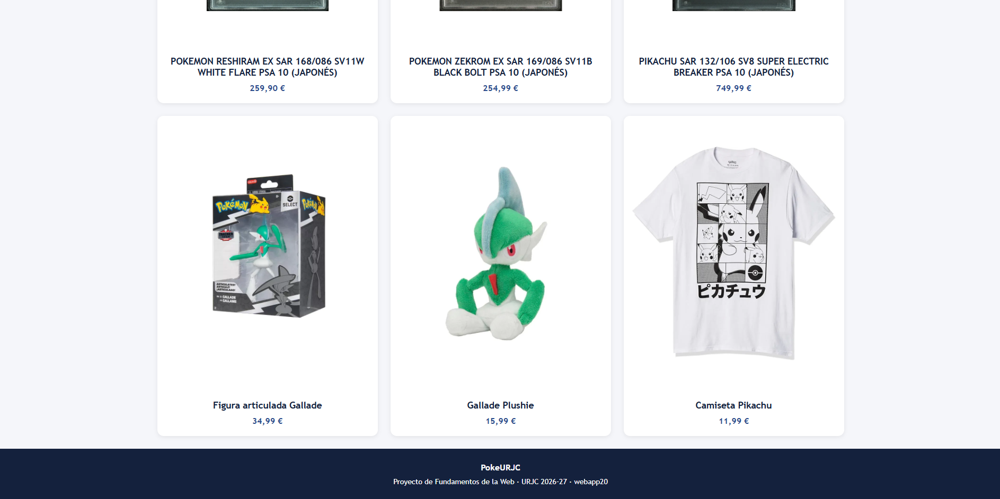
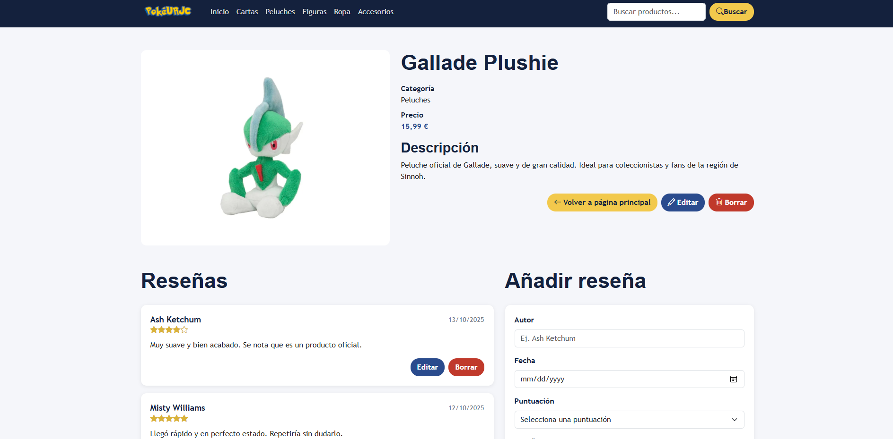
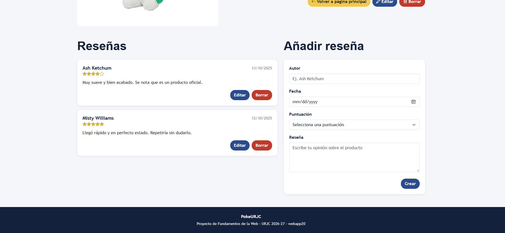
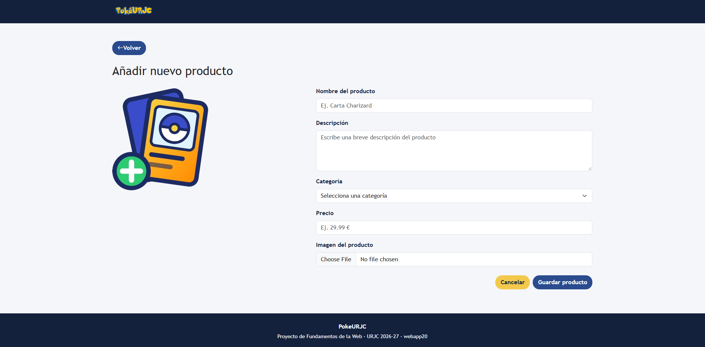

# PokeURJC

### webapp20

> *A web application for browsing and selling Pokémon products.*

---

## Members

| Name and Surnames | University Mail | GitHub Username |
|-------------------|-----------------|-----------------|
| Ignacio Roncero Medina | i.roncero.2024@alumnos.urjc.es | [NachoRonc](https://github.com/NachoRonc) |
| Rim Afoud | r.afoud.2024@alumnos.urjc.es | [rimafd](https://github.com/rimafd) |
| Sergio Alejandro Romero | sa.romero.2024@alumnos.urjc.es | [sergioromero2k](https://github.com/sergioromero2k) |
| Alvaro Martin Jurado | a.martinju.2026@alumnos.urjc.es | [AlvaritoMartin87](https://github.com/AlvaritoMartin87) |

---

## Coordination Tools

- **GitHub Projects:** [PokeURJC Backlog](LINK_TO_THE_PUBLIC_PROJECT)

---

## Project Description

**PokeURJC** is a web application focused on **browsing and selling Pokémon products**.

The application allows users to **explore a collection of Pokémon related products** (cards, plushies, figures, clothing and accessories) and access detailed information about each product, such as its **name, description, category and price**.

Users can also **add, edit and delete Pokémon products**. Each product has an associated **image** and can receive **reviews from users**.

The main objective of **PokeURJC** is to provide a **simple and intuitive platform** where users can **discover, view and sell Pokémon products**.

---

## Functionality

### Main Entity: Pokémon Product

| Attribute | Type | Rules |
|-----------|------|-------|
| Name | Text | Required, unique, must start with a capital letter |
| Description | Long text | Required, between 20 and 500 characters |
| Category | Selection | Cartas, Peluches, Figuras, Ropa or Accesorios |
| Price | Number | Required, greater than 0 |
| Image | Image | Required when creating the product |

### Secondary Entity: Review

| Attribute | Type | Rules |
|-----------|------|-------|
| Title | Text | Required, not repeated in the same product (max. 80 characters) |
| Author | Text | Required (max. 50 characters) |
| Date | Date | Required, valid date |
| Rating | Number | Integer from 1 to 5 |
| Text | Long text | Required, between 10 and 300 characters |

Each product can have several reviews. A review always belongs to one product.

### Images

Only the main entity (**Pokémon Product**) has an associated image.

### Search, Filtering and Categorization

- **Search:** the search box in the navigation bar shows the products whose **name** contains the text entered.
- **Categorization:** products are grouped by **category**. Each category has a link in the navigation bar that shows only the products of that category.

---

## How to Commit

### Before your first commit (only once per computer)

Activate the team's pre-push reminder:

```
git config core.hooksPath .githooks
```

Before every push it will ask if you have told the team about your changes. Answer `S` to continue or `N` to cancel.

### Steps

1. Check which files you have changed:
   ```
   git status
   ```
2. Add the file you want to save:
   ```
   git add <file>
   ```
3. Commit with a message that explains the change:
   ```
   git commit -m "type(scope): description in English"
   ```
   Examples:
   - `feat(detail): add reviews list` → something new
   - `fix(grid): correct columns on mobile` → fix a bug
   - `style(css): change button colors` → visual change
   - `docs(readme): add screenshots` → documentation
4. Push your commits:
   ```
   git push
   ```

Make **one commit per change**, not one huge commit at the end of the day.

---

## Práctica 1

### Screenshots

#### Main page





#### Product detail page




#### New product page



### Members' Participation

#### Rim Afoud

**Tasks:**
- Improved the layout and grid structure of the main page.
- Developed the new Pokémon product creation page.
- Refined the CSS styling of buttons and titles.

**5 most significant commits:**
1. [Grid layout changes in home page](https://github.com/CodeURJC-FW-2026-27/webapp20/commit/7025612e1018deb83c0fccf53935b0eb42127918)
2. [CSS button styling](https://github.com/CodeURJC-FW-2026-27/webapp20/commit/499035fe58c3a605e48e517c1db585494398097d)
3. [New product page](https://github.com/CodeURJC-FW-2026-27/webapp20/commit/fc1f7a041c0139fc623dfe40678c048108504901)
4. [Fixing logo in new product page](https://github.com/CodeURJC-FW-2026-27/webapp20/commit/30870fb4037f6c32ecff78ee39bf0ae661bac004)
5. [Title styling](https://github.com/CodeURJC-FW-2026-27/webapp20/commit/fc0abffc8b1d596c5a3f75aeb9274c90ca7350b0)

**5 files with most participation:**
1. [new-product.html](https://github.com/CodeURJC-FW-2026-27/webapp20/blob/practica1/new-product.html)
2. [resources/PokeURJC.css](https://github.com/CodeURJC-FW-2026-27/webapp20/blob/practica1/resources/PokeURJC.css)
3. [index.html](https://github.com/CodeURJC-FW-2026-27/webapp20/blob/practica1/index.html)
4. [README.md](https://github.com/CodeURJC-FW-2026-27/webapp20/blob/practica1/README.md)
5. [TODO](LINK)

---

#### Ignacio Roncero Medina

**Tasks:**
- Added the search bar and changed the products of the main page.
- Assisted in the development of the main page.

**5 most significant commits:**
1. [Changes in products](https://github.com/CodeURJC-FW-2026-27/webapp20/commit/eb34001818561906a60cf1176e3c618358c1b96e)
2. [Search bar, attribute changes](https://github.com/CodeURJC-FW-2026-27/webapp20/commit/6c14ed3f54b7eb6aca4b6b1b075729ad9575926a)
3. [TODO](LINK)
4. [TODO](LINK)
5. [TODO](LINK)

**5 files with most participation:**
1. [index.html](https://github.com/CodeURJC-FW-2026-27/webapp20/blob/practica1/index.html)
2. [detail.html](https://github.com/CodeURJC-FW-2026-27/webapp20/blob/practica1/detail.html)
3. [TODO](LINK)
4. [TODO](LINK)
5. [TODO](LINK)

---

#### Sergio Alejandro Romero

**Tasks:**
- Set up the base of the repository: `.gitignore`, functionality section of the README and Git workflow guide.
- Organized the team backlog in GitHub Projects (issues, labels and assignments).
- Adapted the Bootstrap *Shop Homepage* template to PokeURJC.
- Built the main page: navigation bar with logo, categories and search box, and hero section with background image.
- Added the featured products carousel by category and the "Crear nuevo elemento" button.
- Created the shared header and footer for all pages.
- Created the base stylesheet: color palette, buttons and titles reused across the site.
- Added a pre-push hook to remind the team to communicate their changes.

**5 most significant commits:**
1. [feat(grid): add main page with navbar, product grid and footer](https://github.com/CodeURJC-FW-2026-27/webapp20/commit/c538623)
2. [feat(grid): add featured products carousel and logo to main page](https://github.com/CodeURJC-FW-2026-27/webapp20/commit/cbeb464)
3. [feat(css): add base styles and color palette](https://github.com/CodeURJC-FW-2026-27/webapp20/commit/962194b)
4. [feat(header): add shared header and footer to new product page](https://github.com/CodeURJC-FW-2026-27/webapp20/commit/6fec6cb)
5. [docs(readme): update functionality and add Practica 1 section](https://github.com/CodeURJC-FW-2026-27/webapp20/commit/269f787)

**5 files with most participation:**
1. [index.html](https://github.com/CodeURJC-FW-2026-27/webapp20/blob/practica1/index.html)
2. [resources/PokeURJC.css](https://github.com/CodeURJC-FW-2026-27/webapp20/blob/practica1/resources/PokeURJC.css)
3. [README.md](https://github.com/CodeURJC-FW-2026-27/webapp20/blob/practica1/README.md)
4. [new-product.html](https://github.com/CodeURJC-FW-2026-27/webapp20/blob/practica1/new-product.html)
5. [.githooks/pre-push](https://github.com/CodeURJC-FW-2026-27/webapp20/blob/practica1/.githooks/pre-push)

---

#### Alvaro Martin Jurado

**Tasks:**
- Created the HTML of the detail page using Bootstrap.
- Adapted the CSS of the detail page.
- Helped with the form of the new product page.

**5 most significant commits:**
1. [Create the HTML for detail.html using Bootstrap](https://github.com/CodeURJC-FW-2026-27/webapp20/commit/c84ae456c9720192b18dbb236875981c7e5da109)
2. [Adapt CSS for detail.html](https://github.com/CodeURJC-FW-2026-27/webapp20/commit/7e9f705c745a5ae70d8bbc7f3220d2a9a09914c9)
3. [Change the form](https://github.com/CodeURJC-FW-2026-27/webapp20/commit/4d5d2a05d3027c8fa7df3786d06cc096bc17aec9)
4. [Change required the elements](https://github.com/CodeURJC-FW-2026-27/webapp20/commit/f8e42d705d48a3eae4127d9eca814f5063875e15)
5. [Change all inputs for required](https://github.com/CodeURJC-FW-2026-27/webapp20/commit/2282c8aee44d0ba1156b8404c70658e94418ebca)

**5 files with most participation:**
1. [detail.html](https://github.com/CodeURJC-FW-2026-27/webapp20/blob/practica1/detail.html)
2. [new-product.html](https://github.com/CodeURJC-FW-2026-27/webapp20/blob/practica1/new-product.html)
3. [resources/PokeURJC.css](https://github.com/CodeURJC-FW-2026-27/webapp20/blob/practica1/resources/PokeURJC.css)
4. [README.md](https://github.com/CodeURJC-FW-2026-27/webapp20/blob/practica1/README.md)
5. [TODO](LINK)

---

## Práctica 2

### Video

[](https://www.youtube.com/watch?v=VIDEO_ID)

### Running Instructions

**Requirements:**
- [Node.js](https://nodejs.org/) 24 or higher
- [MongoDB Community Server](https://www.mongodb.com/try/download/community) TODO_VERSION, running on `localhost:27017`

**Steps:**

1. Clone the repository:
   ```
   git clone https://github.com/CodeURJC-FW-2026-27/webapp20.git
   cd webapp20
   ```
2. Install the dependencies:
   ```
   npm install
   ```
3. Start MongoDB (as a service or with MongoDB Compass).
4. Start the application:
   ```
   npm start
   ```
5. Open [http://localhost:3000](http://localhost:3000) in the browser.

On every start, the application copies the sample product images from `data/` to `uploads/`. When the database is empty, it also loads the sample products and reviews from `data/data.json`.

### Files Description

| File | Description |
|------|-------------|
| `src/app.js` | Creates the Express server, configures Mustache templates and partials, serves static files and the `uploads` folder, and starts the server on port 3000. |
| `src/router.js` | Defines all the routes: main page with search, categories and pagination, product detail, create, edit and delete products and reviews. Validates the data received and renders confirmation or error pages. |
| `src/products.js` | Connects to MongoDB and contains all the database operations for products and their reviews. |
| `src/load_data.js` | Copies sample images from `data/` to `uploads/` and loads sample products from `data/data.json` when the database is empty. |
| `data/data.json` | Sample products with their reviews and image filenames. |
| `data/*.webp` | Source images for the sample products. |
| `views/index.html` | Main page: product grid, search results, category filter and pagination. |
| `views/detail.html` | Product detail with its reviews and the form to add a new review. |
| `views/new-product.html` | Form to create a new product, also used to edit an existing one. |
| `views/edit-review.html` | Form to edit a review. |
| `views/confirmation.html` | Confirmation page shown after creating, editing or deleting products and reviews. |
| `views/error.html` | Error page with a message and a link to go back. |
| `views/partials/header.html` | Page head and navigation bar shared by all pages. |
| `views/partials/footer.html` | Footer shared by all pages. |
| `public/PokeURJC.css` | Stylesheet of the application. |
| `public/images/` | Logo and static images of the website. |

### Members' Participation

#### Rim Afoud

**Tasks:**
- Adapted the main and detail pages to Mustache templates.
- Implemented deleting and editing products from the detail page.
- Implemented editing and deleting reviews.
- Fixed the images in the main and detail pages and connected the category links to the filters.

**5 most significant commits:**
1. [feat: added delete product feature](https://github.com/CodeURJC-FW-2026-27/webapp20/commit/4d4ac30)
2. [feat: Edit product in detail page](https://github.com/CodeURJC-FW-2026-27/webapp20/commit/418f4f0)
3. [feat: Edit reviews](https://github.com/CodeURJC-FW-2026-27/webapp20/commit/301621a)
4. [feat: delete reviews](https://github.com/CodeURJC-FW-2026-27/webapp20/commit/6b9606f)
5. [index and detail new templates](https://github.com/CodeURJC-FW-2026-27/webapp20/commit/d7c1b2f)

**5 files with most participation:**
1. [src/router.js](https://github.com/CodeURJC-FW-2026-27/webapp20/blob/main/src/router.js)
2. [src/load_data.js](https://github.com/CodeURJC-FW-2026-27/webapp20/blob/main/src/load_data.js)
3. [views/index.html](https://github.com/CodeURJC-FW-2026-27/webapp20/blob/main/views/index.html)
4. [data/data.json](https://github.com/CodeURJC-FW-2026-27/webapp20/blob/main/data/data.json)
5. [views/detail.html](https://github.com/CodeURJC-FW-2026-27/webapp20/blob/main/views/detail.html)

---

#### Ignacio Roncero Medina

**Tasks:**
- Implemented funcitonal ¨New Product¨.
- Reviewd the whole web in search for problems later solved himself.
- Got header working in all pages.
- Changed the routing of the images to the correct folders.
- Fixed some reviews atributes problems.

**5 most significant commits:**
1. [Creación de nuevo elemento y comprobaciones de servidor de formulario de creación de nuevo elemento.](https://github.com/CodeURJC-FW-2026-27/webapp20/commit/343284a2402d584e28cf2df2f05ae53e2f0f6778)
2. [Visualización correcta de los títulos y puntuajes de las reviews](https://github.com/CodeURJC-FW-2026-27/webapp20/commit/f134e06244001ea7e0b81099b2691ecc4e40619d)
3. [Header funcional en todas las vistas](https://github.com/CodeURJC-FW-2026-27/webapp20/commit/1395f40eb0a1ce27ad91bbf60a223b53a54e41cc)
4. [Imagenes de la demo en carpeta data](https://github.com/CodeURJC-FW-2026-27/webapp20/commit/183ba91f4e2eeaf16f35690704a88d4f549a6432)

**5 files with most participation:**
1. [src/router.js](https://github.com/CodeURJC-FW-2026-27/webapp20/blob/main/src/router.js)
2. [src/load_data.js](https://github.com/CodeURJC-FW-2026-27/webapp20/blob/main/src/load_data.js)
3. [src/product.js](https://github.com/CodeURJC-FW-2026-27/webapp20/blob/main/src/products.js)
4. [views/new-product.html](https://github.com/CodeURJC-FW-2026-27/webapp20/blob/main/views/new-product.html)
5. [views/detail.html](https://github.com/CodeURJC-FW-2026-27/webapp20/blob/main/views/detail.html)

---

#### Sergio Alejandro Romero

**Tasks:**
- Acted as the reviewer of the team: checked the whole application against the requirements of the assignment and fixed the issues found.
- Unified the creation and edition of products in a single form and a single processing function, as required by the assignment.
- Added full server-side validation of products: unique name, capital letter, description length, price range and image type.
- Removed duplicated code: one listing function for search, categories and pagination, shared helpers in the router, and a single confirmation page.
- Added error handling so the server shows an error page instead of crashing, and fixed the Mustache partials configuration.
- Fixed the sample data (numeric prices and ratings, review titles) and set the review date automatically.
- Removed the uploads folder from the repository and added it to the `.gitignore`.

**5 most significant commits:**
1. [refactor(router): reuse product form logic, add full validation and helpers](https://github.com/CodeURJC-FW-2026-27/webapp20/commit/5892882)
2. [refactor(form): reuse product form for create and edit](https://github.com/CodeURJC-FW-2026-27/webapp20/commit/f36a2a1)
3. [refactor(products): merge listing functions and escape search text](https://github.com/CodeURJC-FW-2026-27/webapp20/commit/5a9ccc7)
4. [refactor(views): remove duplicated confirmation pages](https://github.com/CodeURJC-FW-2026-27/webapp20/commit/83a8dae)
5. [fix(data): add review titles and dates, use numbers for price and rating](https://github.com/CodeURJC-FW-2026-27/webapp20/commit/994786a)

**5 files with most participation:**
1. [src/router.js](https://github.com/CodeURJC-FW-2026-27/webapp20/blob/main/src/router.js)
2. [src/products.js](https://github.com/CodeURJC-FW-2026-27/webapp20/blob/main/src/products.js)
3. [views/new-product.html](https://github.com/CodeURJC-FW-2026-27/webapp20/blob/main/views/new-product.html)
4. [views/detail.html](https://github.com/CodeURJC-FW-2026-27/webapp20/blob/main/views/detail.html)
5. [views/partials/header.html](https://github.com/CodeURJC-FW-2026-27/webapp20/blob/main/views/partials/header.html)
---

#### Alvaro Martin Jurado

**Tasks:**
- Implemented pagination in the database (6 products per page) with page links and previous/next navigation.
- Added the search by product name.
- Added the category filter.
- Created the footer partial and dynamic page titles with Mustache.

**5 most significant commits:**
1. [feat: add database pagination (6 items/page) with page links and prev/next navigation](https://github.com/CodeURJC-FW-2026-27/webapp20/commit/58dd170)
2. [feat: add search filter by main entity name or title](https://github.com/CodeURJC-FW-2026-27/webapp20/commit/29eb22c)
3. [feat: add category/section/genre filter buttons for main items](https://github.com/CodeURJC-FW-2026-27/webapp20/commit/f8b2ca3)
4. [feat: add footer component using Mustache templates](https://github.com/CodeURJC-FW-2026-27/webapp20/commit/90f751f)
5. [feat: add dynamic page titles using Mustache](https://github.com/CodeURJC-FW-2026-27/webapp20/commit/ca3fbd4)

**5 files with most participation:**
1. [src/products.js](https://github.com/CodeURJC-FW-2026-27/webapp20/blob/main/src/products.js)
2. [src/router.js](https://github.com/CodeURJC-FW-2026-27/webapp20/blob/main/src/router.js)
3. [views/index.html](https://github.com/CodeURJC-FW-2026-27/webapp20/blob/main/views/index.html)
4. [views/partials/header.html](https://github.com/CodeURJC-FW-2026-27/webapp20/blob/main/views/partials/header.html)
5. [views/partials/footer.html](https://github.com/CodeURJC-FW-2026-27/webapp20/blob/main/views/partials/footer.html)