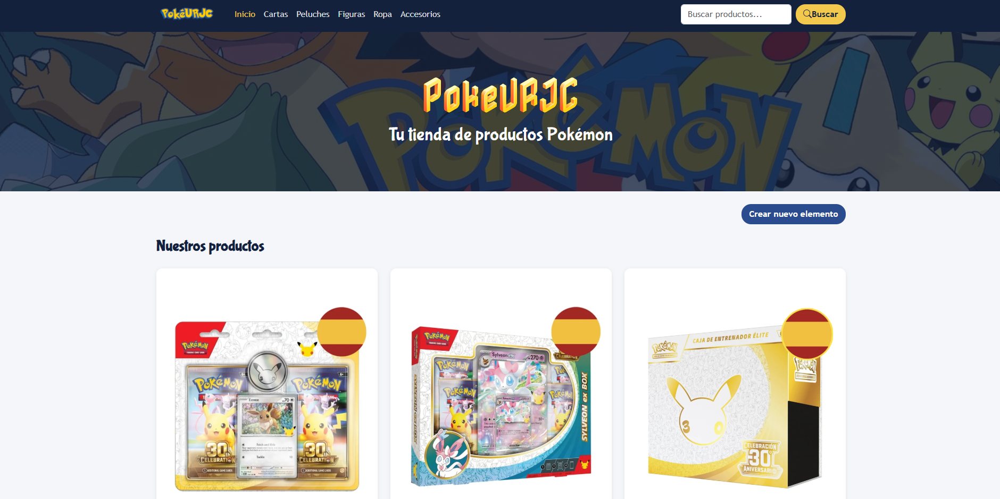
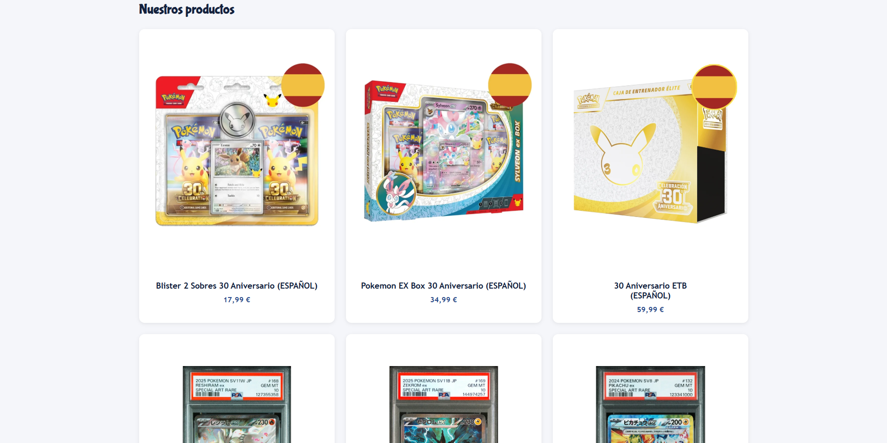
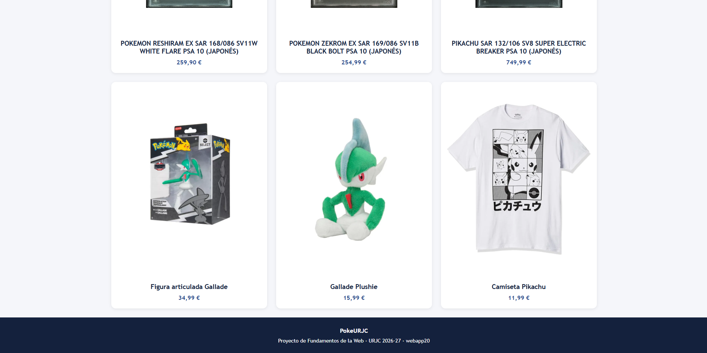
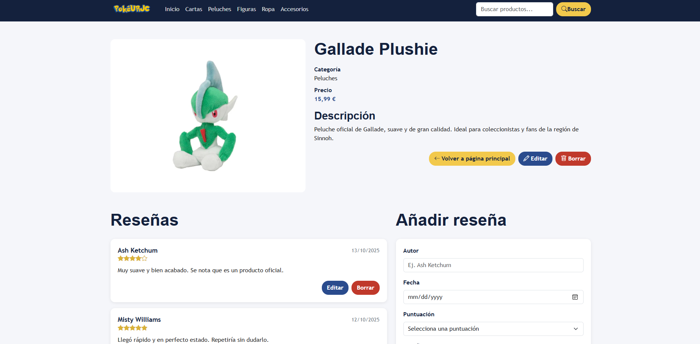
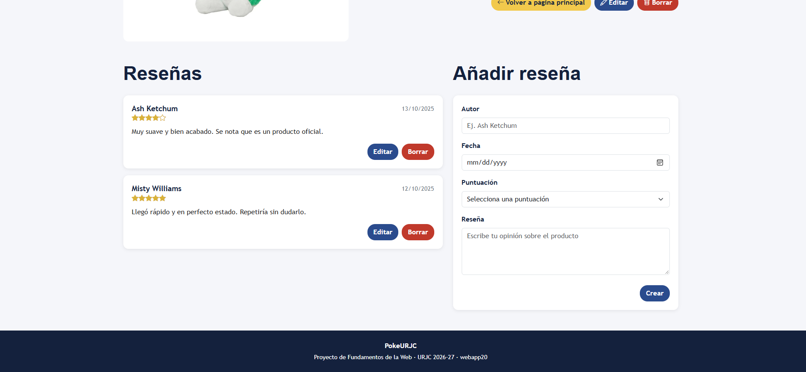
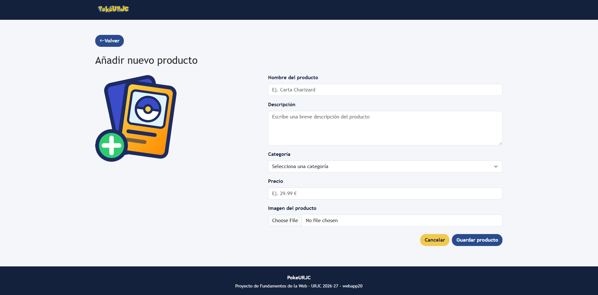

# PokeURJC
### webapp20

> *A web application for browsing and selling Pokémon products.*
--------------------------------------------------------------------------
## Members

| Name and Surnames | University Mail | Github Username |
|-----------|-----------|-----------|
| Ignacio Roncero Medina   | i.roncero.2024@alumnos.urjc.es   | NachoRonc   |
| Rim Afoud  |  r.afoud.2024@alumnos.urjc.es | rimafd  |
| Sergio Alejandro Romero    | sa.romero.2024@alumnos.urjc.es    | sergioromero2k   |
| Alvaro Martin Jurado  |  a.martinju.2026@alumnos.urjc.es | AlvaritoMartin87  |

--------------------------------------------------------------------------
## Cordination Tools:

None in use for now.

--------------------------------------------------------------------------

## Project Description
**PokeURJC** is a web application focused on **browsing and selling Pokémon products.**

The application allows users to **explore a collection of Pokémon related products** and access detailed information about each product, such as its **name, price, description, Pokémon and product type.**
Users can also **add new Pokémon products** to the application. Each product can have an associated **image** and **reviews from users.**
The main objective of **PokeURJC** is to provide a **simple and intuitive platform** where users can **discover, view and sell Pokémon products.**

## Functionality

### Main Entity: Pokémon Product

Each product will contain the following information:

- Name
- Price
- Description
- Product Type
- Image

### Secondary Entity: Review

- Author
- Rating
- Date

### Images
Only the main entity (**Pokémon Product**) will have an associated image.

## Project - Part 1

### Screenshots

**Home Page**

**Product Detail Page**

**Add New Product Page**

### Members' participation 

#### Rim Afoud
**Tasks:**
- Fixed the layout and grid structure of the main page.
- Developed the page for adding new Pokémon products.
- Made some CSS adjustments to improve button styling.

**5 most significant commits:**  
1. [Grid layout changes in home page](https://github.com/CodeURJC-FW-2026-27/webapp20/commit/7025612e1018deb83c0fccf53935b0eb42127918)
2. [CSS button styling](https://github.com/CodeURJC-FW-2026-27/webapp20/commit/499035fe58c3a605e48e517c1db585494398097d)
3. [New product page](https://github.com/CodeURJC-FW-2026-27/webapp20/commit/fc1f7a041c0139fc623dfe40678c048108504901)
4. [Fixing logo in new product page](https://github.com/CodeURJC-FW-2026-27/webapp20/commit/30870fb4037f6c32ecff78ee39bf0ae661bac004)
5. [Title styling](https://github.com/CodeURJC-FW-2026-27/webapp20/commit/fc0abffc8b1d596c5a3f75aeb9274c90ca7350b0)

**Files with most participation:**  
- `new-product.html`
- `PokeURJC.css`
- `index.html`

  
---

#### Ignacio Roncero Medina 
**Tasks:**  
- Added search bar and changed the products of the main page
- Assisted in the development of the main page.

  
**5 most significant commits:**  
1. [Changes in products](https://github.com/CodeURJC-FW-2026-27/webapp20/commit/eb34001818561906a60cf1176e3c618358c1b96e)
2. [Search bar, atribute changes](https://github.com/CodeURJC-FW-2026-27/webapp20/commit/6c14ed3f54b7eb6aca4b6b1b075729ad9575926a)
3. [Commit 3]
4. [Commit 4]
5. [Commit 5]

**Files with most participation:**  
- `index.html`
- `detail.html`

---

#### **Sergio Alejandro Romero**

**Tasks:**
- Set up the base of the repository: `.gitignore`, functionality section of the README and Git workflow guide.
- Organized the team backlog in GitHub Projects (issues, labels and assignments).
- Adapted the Bootstrap *Shop Homepage* template to PokeURJC.
- Built the main page: navigation bar with logo, categories and search box, and hero section with background image.
- Added the featured products carousel by category and the "Crear nuevo elemento" button.
- Created the shared header and footer for all pages.
- Created the base stylesheet: color palette, buttons and titles reused across the site.
- Added a pre-push hook to remind the team to communicate their changes.

**5 most significant commits:**

1. [feat(grid): add main page with navbar, product grid and footer](https://github.com/CodeURJC-FW-2026-27/webapp20/commit/c538623)
2. [feat(grid): add featured products carousel and logo to main page](https://github.com/CodeURJC-FW-2026-27/webapp20/commit/cbeb464)
3. [feat(css): add base styles and color palette](https://github.com/CodeURJC-FW-2026-27/webapp20/commit/962194b)
4. [feat(header): add shared header and footer to new product page](https://github.com/CodeURJC-FW-2026-27/webapp20/commit/6fec6cb)
5. [docs(readme): update functionality and add Practica 1 section](https://github.com/CodeURJC-FW-2026-27/webapp20/commit/269f787)

**5 files with most participation:**

1. [index.html](https://github.com/CodeURJC-FW-2026-27/webapp20/blob/main/index.html)
2. [resources/PokeURJC.css](https://github.com/CodeURJC-FW-2026-27/webapp20/blob/main/resources/PokeURJC.css)
3. [README.md](https://github.com/CodeURJC-FW-2026-27/webapp20/blob/main/README.md)
4. [new-product.html](https://github.com/CodeURJC-FW-2026-27/webapp20/blob/main/new-product.html)
5. [.githooks/pre-push](https://github.com/CodeURJC-FW-2026-27/webapp20/blob/main/.githooks/pre-push)

---

#### Alvaro Martin Jurado
**Tasks:**  
Create the HTML for detail.html using Bootstrap.
Adapt the CSS for detail.html.
Help with the option from new-product.html

**5 most significant commits:**  
1.[Create the HTML for detail.html using Bootstrap.](https://github.com/CodeURJC-FW-2026-27/webapp20/commit/c84ae456c9720192b18dbb236875981c7e5da109)
2.[Adapt Css for detail.html](https://github.com/CodeURJC-FW-2026-27/webapp20/commit/7e9f705c745a5ae70d8bbc7f3220d2a9a09914c9)
3.[Change the form](https://github.com/CodeURJC-FW-2026-27/webapp20/commit/4d5d2a05d3027c8fa7df3786d06cc096bc17aec9)
4.[Change required the elements](https://github.com/CodeURJC-FW-2026-27/webapp20/commit/f8e42d705d48a3eae4127d9eca814f5063875e15)
5.[Change all inputs for required](https://github.com/CodeURJC-FW-2026-27/webapp20/commit/2282c8aee44d0ba1156b8404c70658e94418ebca)

**Files with most participation:**  
[detail.html](https://github.com/CodeURJC-FW-2026-27/webapp20/blob/main/detail.html)
[new-product.html](https://github.com/CodeURJC-FW-2026-27/webapp20/blob/main/new-product.html)
[PokeURJC.css](https://github.com/CodeURJC-FW-2026-27/webapp20/blob/main/resources/PokeURJC.css)
[Readme.md](https://github.com/CodeURJC-FW-2026-27/webapp20/blob/main/README.md)

